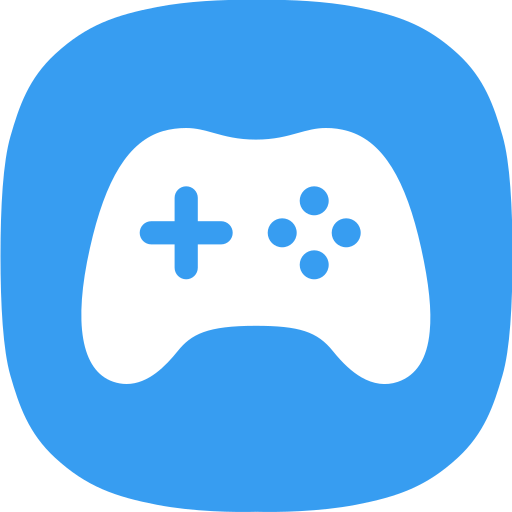

# CV GAMES



**CV GAMES** é um portal independente de jogos para navegador, criado e mantido por **Eduardo Valentin Carneiro**. O projeto reúne jogos originais, um catálogo de títulos de terceiros, downloads e recursos para a comunidade gamer.

🌐 **Site:** [cvgames.com.br](https://cvgames.com.br/)  
🕹️ **Jogos:** [Explorar o catálogo](https://cvgames.com.br/#jogos)  
✨ **Novidades:** [Atualizações do site](https://cvgames.com.br/novidades.html)  
📚 **Arquivo de novidades:** [Atualizações anteriores](https://cvgames.com.br/novidades-2.html)

### Atualizações públicas — 19/10/2026

- **WASM Arcade:** novo portal externo de jogos de arcade na área Todos os jogos.
- **Minecraft - GX Launcher:** acesso ao Minecraft 26.3 pelo GX Launcher, agora como a única opção de Minecraft no catálogo.

## Sobre o projeto

O CV GAMES foi desenvolvido para tornar fácil descobrir e jogar diretamente no navegador, tanto no computador quanto no celular. A interface, a organização do portal e os jogos identificados como projetos CV foram feitos para este projeto.

### Jogos autorais

- **CV STARFALL** — ação espacial com naves, habilidades, ondas e chefes.
- **CV LABIRINTO: ESTAÇÃO PERDIDA** — exploração de uma estação tomada por robôs, com labirintos, cartões de acesso e limite de tempo.
- **CV NEON BREAKER** — arcade de blocos com fases e habilidades.
- **CV XADREZ** e **CV DAMAS** — jogos de tabuleiro para duas pessoas no mesmo dispositivo.
- **CV QUADRADOS** e **CV JOGO DA VELHA** — desafios locais para dois jogadores.
- **CV TURBO CIRCUIT** — corrida vista de cima contra pilotos controlados pelo jogo.
- **CV DEFESA ORBITAL** — estratégia de defesa por ondas.
- **NEXUS: Rota Zero** — aventura narrativa interativa criada por educvv.

Alguns jogos podem estar em desenvolvimento, em teste ou com acesso limitado enquanto recebem atualizações.

## Recursos do portal

- Catálogo pesquisável, filtros por categoria e jogos em destaque.
- Layout responsivo para celular e computador, com temas claro e escuro.
- Favoritos, perfil e histórico de jogos salvos localmente no navegador.
- Páginas próprias para os jogos CV, com controles e configurações específicos de cada jogo.
- Central gamer, downloads e páginas informativas.
- Emulador de NES que carrega arquivos compatíveis escolhidos pelo usuário no próprio navegador. O portal não fornece ROMs comerciais.
- Link para o PPSSPP Web, serviço externo para abrir jogos PSP do próprio usuário.

## Tecnologias

O site é uma aplicação estática feita com **HTML, CSS e JavaScript**, sem etapa de compilação. Os jogos usam recursos do navegador, como Canvas, áudio e armazenamento local, conforme a experiência.

## Organização dos arquivos

| Caminho | Conteúdo |
| --- | --- |
| `index.html` | Página inicial e catálogo |
| `data/jogos.js` | Cadastro dos jogos e destinos do catálogo |
| `games/` | Páginas, código e recursos dos jogos |
| `css/` | Estilos do portal e dos jogos |
| `js/` | Busca, perfil local, estatísticas e interações do site |
| `img/` | Logos, capas e imagens do portal |
| `music/` | Músicas usadas em jogos compatíveis |
| `central.html` | Central gamer e links de utilidade |
| `emuladores.html` | Seletor e informações dos emuladores |
| `baixar.html` | Área de downloads |
| `novidades.html` | Registro público das atualizações |
| `novidades-2.html` | Arquivo das atualizações anteriores |

## Executar localmente

Como o projeto é estático, não é necessário instalar dependências ou compilar. Você pode servir a pasta do projeto com qualquer servidor HTTP local. Por exemplo, com Python instalado:

```bash
python -m http.server 8000
```

Depois, abra `http://localhost:8000` no navegador.

## Publicação

O site é publicado pelo **GitHub Pages** e usa o domínio personalizado [cvgames.com.br](https://cvgames.com.br/). Para publicar alterações, envie os arquivos atualizados para o repositório configurado nas opções de Pages do GitHub.

## Autoria e conteúdo de terceiros

Os jogos CV listados como autorais, o código e os elementos visuais criados especificamente para eles fazem parte do projeto CV GAMES. O catálogo também contém links para jogos e serviços de terceiros — por exemplo, o **WASM Arcade** — que abrem sites externos e não são propriedade do CV GAMES. Marcas, jogos, bibliotecas e materiais de terceiros pertencem aos respectivos titulares e podem ter termos e licenças próprios.

O código do repositório está coberto pela licença [MIT](LICENSE). Essa licença não substitui os termos aplicáveis a conteúdo de terceiros incluído ou referenciado no projeto.

---

**CV GAMES © 2026 · Criado por Eduardo Valentin Carneiro**
